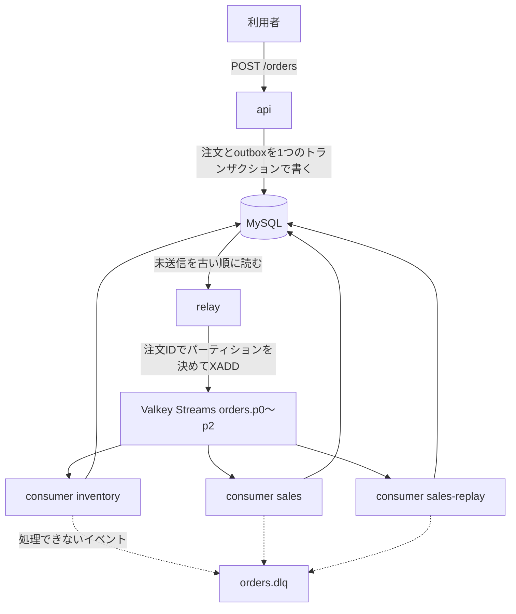

# event-streaming-valkey

GoとMySQLとValkey Streamsで組んだ、イベントストリーミングの最小構成です。注文の確定と取消をイベントとして流し、在庫の引当と売上の集計という2つの読み手が、それぞれ独立に受け取ります。

## 構成



| プロセス | 役割 |
| --- | --- |
| `cmd/api` | 注文の受け付けと取消、集計の読み出しをHTTPで提供します |
| `cmd/relay` | outboxの未送信イベントをValkey Streamsへ送ります。順序を保つため1つだけ動かします |
| `cmd/consumer` | 1つのコンシューマグループとして全パーティションを読み、集計を更新します |

## 動かす

Go 1.27以上とDockerが必要です。標準ライブラリの`uuid`と`encoding/json/v2`を使っているためです。

```sh
make up      # compose で全体を起動する
curl -s -X POST localhost:8080/orders -d '{"product_id":"apple","quantity":1,"amount":100}'
curl -s localhost:8080/stock
curl -s 'localhost:8080/sales?projection=sales'
make down    # 止めてボリュームも消す
```

apiは学習用のローカル専用で、認証はありません。Hostがループバック（`localhost`、`127.0.0.1`、`::1`）の要求だけを受け付け、別のサイトを開いたブラウザからの書き込みも拒みます。

`make e2e`は全体を起動し、次のふるまいをHTTPとCLIで確かめてから片付けます。終了後も環境を残したいときは`KEEP=1 make e2e`です。

- 2つの読み手が同じ注文をそれぞれ集計する
- 確定の直後に取り消した注文の引当が残らない
- 片方の読み手が止まっても、もう片方は進み、再開すると追いつく
- MySQLが止まっている間は読み手がその場で再試行し、再起動しても未ACK分を引き取って順番どおりに片付ける
- relayが同じイベントを送り直しても集計が二重にならない
- 壊れたイベントはDLQへ退避し、後ろのイベントは止まらない
- 後から加えた読み手がストリームの先頭から集計を作り直す

## 設定

環境変数で指定します。未指定なら既定値を使います。

| 変数 | 既定値 | 意味 |
| --- | --- | --- |
| `MYSQL_DSN` | なし（必須） | MySQLの接続先 |
| `VALKEY_ADDR` | `localhost:6379` | Valkeyの接続先 |
| `HTTP_ADDR` | `127.0.0.1:8080` | apiの待ち受け先。composeでは`:8080`を渡し、公開先を`127.0.0.1`に絞る |
| `TOPIC` | `orders` | ストリーム名の接頭辞 |
| `PARTITIONS` | `3` | パーティション数。運用を始めたら変えません |
| `STREAM_MAXLEN` | `10000` | 1パーティションに残すおおよその件数 |
| `HANDLER` | `inventory` | consumerの読み手の種類（`inventory`か`sales`） |
| `GROUP` | `HANDLER`と同じ | コンシューマグループ名 |
| `START` | `0` | グループを新しく作るときの開始位置（`0`か`$`） |
| `MAX_ATTEMPTS` | `3` | 一時的な失敗をその場でやり直す上限回数 |
| `RETRY_DELAY` | `1s` | やり直すまでの待ち時間 |

## 品質ゲート

```sh
make ci        # gofmt・go vet・staticcheck・golangci-lint・govulncheck・テスト・カバレッジ・CRAP
make mutation  # gremlins のミュータントがすべて KILLED になることを確かめる
make quality   # ci と mutation と e2e
```

テストはtestcontainersで実際のMySQLとValkeyを起動します。`go test -short ./...`はコンテナを使うテストを飛ばします。

## ライセンス

MIT
